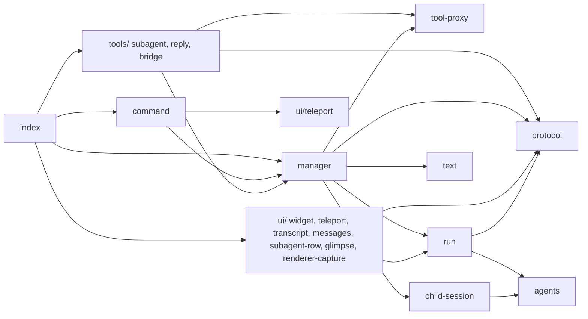

# subagents

Delegates focused tasks to child pi sessions that run inside the main pi process.
Only the child's final report enters the main agent's context.

## Use

- The main agent calls the `subagent` tool with an agent name, a self-contained task, `background`, and optionally `model`.
  `model` picks the model for that call only, in front of the agent file's `model` and the main session's model.
- A widget above the editor shows each run: activity icon, last tool, last line of text, tokens, cost and model.
- `/subagents` opens a run in an overlay with its live transcript.
  Text typed there answers a pending question, steers a running agent, or resumes a finished one.
  Ctrl+O expands tool rows, Ctrl+X aborts, Esc closes.
- `/subagents gate` toggles review of the main agent's replies to subagents: send, edit, or reject with a note.

## Agent files

Each `agents/<name>.md` defines one agent, and the file name is the agent name.

```markdown
---
description: Adversarial reviewer. Read-only.   # required
tools: read, grep, find, ls, bash               # required, string or list
model: openrouter/deepseek/deepseek-v4-flash    # optional, default: main session's model
thinking: low                                   # optional, off|minimal|low|medium|high|xhigh|max
---

System prompt for the agent.
```

Agent files load once per extension load, so run `/reload` after editing them.
An invalid file disables the tool and its error names the file.

## Architecture



| Module | Job |
|---|---|
| `index.ts` | Composition root: builds the proxy and manager, registers tools, renderers, the command and events. |
| `command.ts` | `/subagents`: picks a run and opens the teleport overlay. |
| `manager.ts` | Owns runs: spawn, drive, foreground wait, ask, reply, user input, abort, shutdown, messages to the main chat. |
| `child-session.ts` | Builds one child `AgentSession` with the SDK. |
| `tool-proxy.ts` | Splits an agent's tools into local built-ins and proxied main-session tools. |
| `run.ts` | State of one run and its live activity. |
| `agents.ts` | Loads and validates `agents/*.md`. |
| `protocol.ts` | Tool names, chat message types, and the shapes shared by tools and renderers. |
| `text.ts` | Result truncation and error text. |
| `tools/` | Tool definitions only: `subagent`, `reply_to_subagent`, and the child's bridge tools. |
| `ui/` | Rendering only: widget, teleport overlay, transcript, chat boxes, tool row, glimpse line, renderer capture. |

`.dependency-cruiser.cjs` enforces the layering: no cycles, leaves import nothing local, `manager` knows no tools or UI, `tools/` never render, `ui/` never drives runs, and only `index.ts` wires.
Check it from this directory:

```bash
npx -y -p typescript -p dependency-cruiser@16 depcruise --config .dependency-cruiser.cjs index.ts
```

## How it works

- `child-session.ts` creates each child with the SDK: an in-memory session, no extensions, skills or context files, and the agent body as the system prompt.
- Built-in tools (`read`, `bash`, `edit`, `write`, `grep`, `find`, `ls`) run in the child.
- Other allowed tools are proxied: the child's call runs through `executeTool()` of the latest main-session `subagent` call, so main-session hooks and permission prompts apply.
- The spawn and reply tools are never given to a child, so subagents cannot nest.
- Children get two bridge tools.
  `message_parent` sends a one-way update.
  `ask_parent` waits for `reply_to_subagent` or a direct answer from the overlay, and runs sequentially so a run has at most one open question.
- A foreground `subagent` call returns early when the child asks a question.
  The run then continues in the background, and its result arrives as a message that starts a main-agent turn.
- Only prompts from the main agent report back with a result.
  Answers, steers and follow-ups typed in the overlay stay with the subagent.
- The child knows this routing: its system prompt explains it, overlay messages arrive labelled as from the user, and `ask_parent` answers say who gave them.
  When the user asks it to report something to the parent, it sends the content with `message_parent`.
- Each run logs who interacted with it and how.
  Closing the overlay after typing in it adds one note to the main chat with that log, the status, and the latest answer, without starting a turn.
  The next result the main agent receives also lists interactions it has not seen yet.
- Each run records the session generation it started in.
  `session_shutdown` bumps the generation first, so children that settle later never send into a closed session.
- Tools often finish in milliseconds, so the widget keeps a tool's icon visible for 1.5 s after it ends.

## Rendering through pi-compact-tools

Tool-row renderers such as pi-compact-tools resolve through the main session's `ExtensionRunner`, which extensions cannot reach.
`installRendererCapture()` wraps `ExtensionRunner.prototype.resolveToolRenderers` to remember that runner the first time the main chat draws a tool row.
The overlay then resolves child rows through the same chain, so they match the main chat.
The wrapper and the runner live on `globalThis`, because `/reload` re-evaluates this module but not pi's prototype.
If the remembered runner is stale, rows fall back to native rendering.

## Known limits

- Pi records proxied tool calls under the latest `subagent` call, even when another child made them.
- Proxied tools stop working after a session switch until the main agent calls `subagent` again.
- Finished runs stay in memory until the session ends.
- In print mode (`pi -p`) pi exits when the main agent settles, so background results are lost.
- Children share the working directory, so two writing children can edit the same file.
